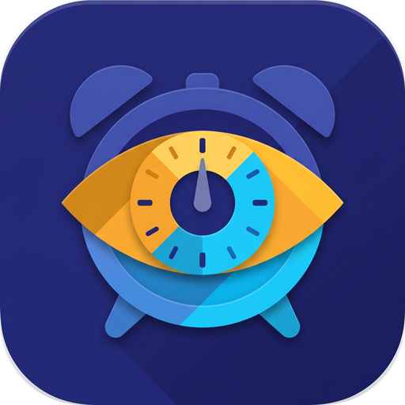
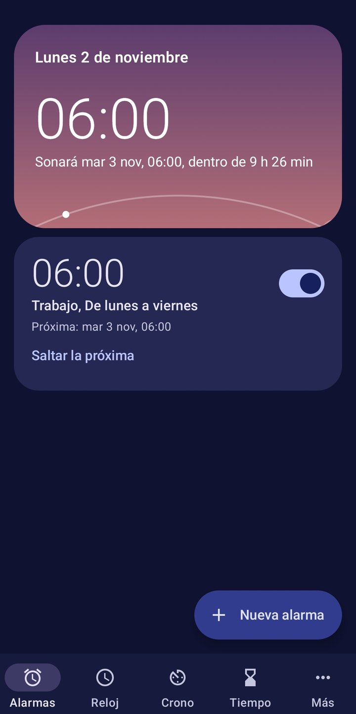
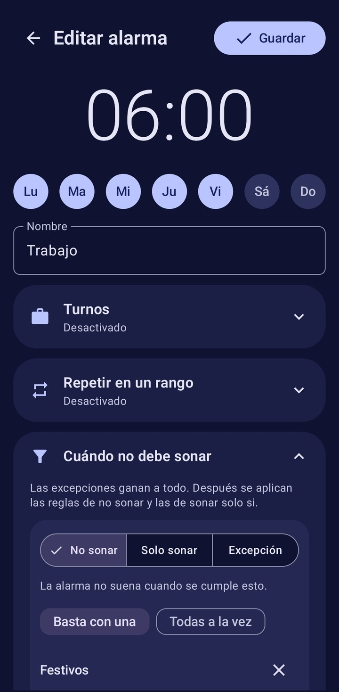
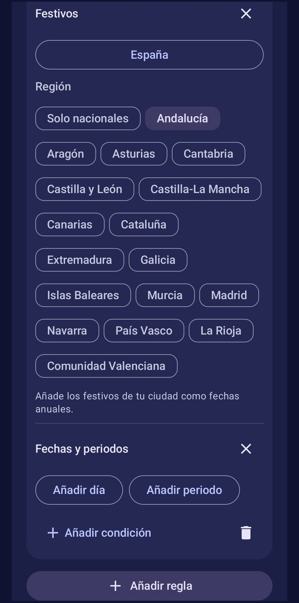
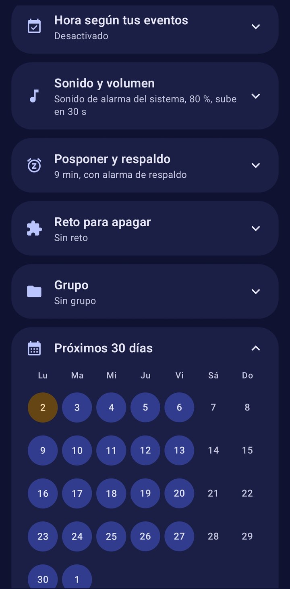
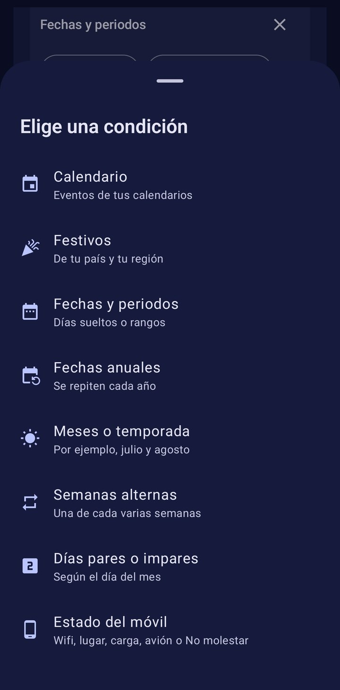
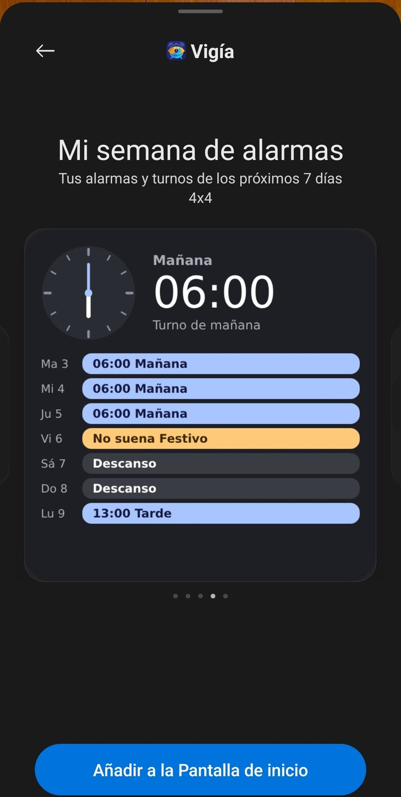
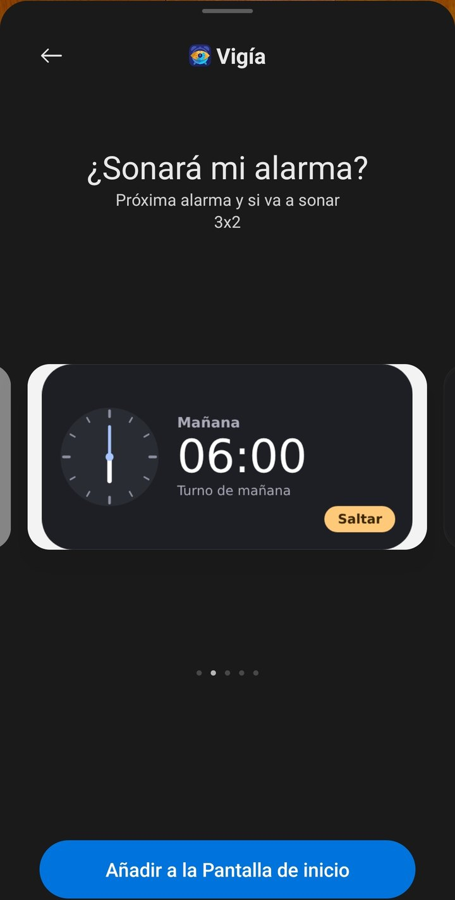

[Español](README.md) · **English**

# Vigía: the alarm that understands your life

**Your life doesn't repeat Monday to Friday. Your alarm shouldn't either.**

Vigía is a free alarm app for Android that decides which days it should ring based on your shifts, your calendar, public holidays and your situation. Set it up once and stop turning alarms on and off every night.

The golden rule is simple: if Vigía doesn't have enough information to decide, the alarm rings.

## Screenshots

The screenshots show the Spanish version. The app also comes in English.

  
  
  

  
  
  

  

## The problems it takes off your hands

### You work shifts

If you work four days and rest two, your week never lines up with the calendar. Regular alarms force you to keep recalculating and changing settings.

With Vigía you create your shifts, each with its own time, and paint your rota day by day. The cycle can be as long as you need, for example three weeks: mornings, afternoons and a week off. Vigía repeats it indefinitely and rings at that shift's time each day.

If a day changes, tap it on the calendar without touching the cycle. If your rota changes every month, you can paint the whole month or add events such as “Morning” or “Afternoon” to your calendar, and Vigía will use each shift's time.

It's a direct help for healthcare staff, police, firefighters, security guards, factory workers, hospitality teams and anyone on a rotating rota.

### Public holidays wake you for nothing

It's a classic: a holiday in the middle of the week, you can finally sleep in, and the usual alarm goes off. Or worse, you turn it off the night before and forget to turn it back on.

Choose your country and region once, and Vigía will skip those holidays every year. Days specific to your city can be added once as yearly dates.

### You go on holiday and forget your alarms

If your time off is already in your Google calendar, there's no need to enter it again. Vigía reads the calendar synced to your phone and stays quiet on those days. When they're over, it comes back by itself.

You can also filter by words, such as “vacation” or “leave”, and use only all-day events.

### Your weeks aren't all the same

Some weeks you're in the office and others you work from home. There's shared custody, alternating classes and routines that change every fortnight.

Vigía understands alternate weeks, even or odd days and specific months. An alarm can rest in July and August and return in September.

### Some days it should only ring if something important is on

You can flip the logic: make the alarm ring only if your calendar has an event called “Office”, and let you sleep on every other day.

It also supports exceptions: don't ring on holidays, unless you have an “On call” event. Exceptions always win, so what matters doesn't get lost.

### Your wake-up time depends on your schedule

If your first appointment changes every day, Vigía can ring before the first event, for example 90 minutes before. You only need to keep your calendar up to date.

### Your situation changes, and your alarm should notice

Vigía can take into account where you are and the state of your phone when it's time to ring: a specific Wi-Fi network, a place, the phone charging, airplane mode or Do Not Disturb.

### You turn off the alarm without waking up

You can require a challenge to dismiss it: solve sums, shake the phone, walk a few steps or scan a QR code you keep in the bathroom or kitchen.

If nobody dismisses it, the backup alarm rings again at full volume. And if you prefer a gentle wake-up, the volume can rise gradually while a sunrise fills the screen.

### You need ten alarms to get up

Some people set an alarm every 5 minutes because one isn't enough. In extreme sleepyhead mode you choose a range and an interval, for example from 06:30 to 07:30 every 5 minutes, and create a single alarm.

There's no snooze button. **Stop** silences it until the next interval and **Stop for today** cancels the rest. If you add a challenge, it's only required to stop it for the day. You can also turn on this mode for a specific shift.

### You have lots of alarms and they change with the season

Groups gather several alarms under one name, such as “Work”, “Summer” or “Kids”. They collapse in the list to keep things tidy, and a single switch turns every alarm in the group on or off.

So when the school year ends, you turn off “School” in one go and bring it back in September without rebuilding anything.

### You want to know what will happen tomorrow

You don't have to trust it blindly. The forecast shows the next 30 days and, when you tap one, explains whether it will ring and why.

The night before, Vigía tells you if an alarm won't ring and offers a button to make it ring anyway. And if you don't need it on a particular day, you can skip just the next one, or change its time just that once. If a rule says it wouldn't ring that day, Vigía warns you and asks you to confirm.

You don't even need to open the app. The widget tells you whether it will ring and why, with a clear colour for each status and in four sizes, from a tiny 2x1 up to one showing your whole week. Its background can be solid, semi-transparent or clear. From there, or from quick settings, you can skip the alarm or make it ring.

## How it works

Each alarm has a time, some days and your rules. Before ringing, Vigía checks:

1. If you asked it to ring that day, it rings.
2. If you skipped that day by hand, it doesn't ring.
3. If an exception applies, it rings.
4. If a don't-ring rule applies, it doesn't ring.
5. If a ring-only-if condition isn't met, it doesn't ring.
6. In any other case, it rings.

Your alarms and calendar data stay on your phone. You don't need to create an account. For holidays, Vigía only sends the country code and saves the dates so they work offline.

If the calendar can't be read or the holidays are missing, the alarm rings and lets you know.

## Everything included

- **Rules:** calendars by account, keywords, all-day or busy events, holidays, dates, months, alternate weeks, even or odd days, and phone status.
- **Shifts:** a paintable rota, cycles of up to 12 weeks, one time per shift, one-off changes, painted months and shifts from your calendar.
- **Alarms:** groups, templates, one-off alarms, repeating within a range, 30-day forecast, and skipping or retiming just the next one.
- **Wake-up:** tone or your own file, maximum volume, gradual rise, vibration and configurable snooze.
- **Dismissal:** sums, shake, walk, QR code and backup alarm.
- **Clock:** other cities, night mode and screensaver.
- **Widgets:** today's or tomorrow's status, the reason, buttons to skip or ring, a week view and a quick settings tile.
- **Stopwatch:** laps, export and persistent notification.
- **Timers:** several at once, named, chained and interval-based.
- **Sleep:** recommended bedtime and statistics for the last 14 days.
- **Control:** history with reasons, a reliability screen and backup.
- **Appearance:** light or dark mode, colour palettes and Material You.

## Requirements

It works on Android 10 or later and is available in English and Spanish. Before relying on it, run the alarm test with your phone locked, because some brands limit background apps.

## Author and rights

Created by manarjomar. © 2026 manarjomar. All rights reserved.

You can download and install Vigía free of charge for personal use. The code is published for reference only: no permission is granted to modify it, redistribute it or publish derivative versions.

International holidays come from [Nager.Date](https://date.nager.at).

## Building

Every push to `main` runs the tests and builds a test APK. To publish a version under **Releases**, change the number in `version.txt` and its notes in `release-notes.md`. Signing uses the `KEYSTORE_BASE64` and `SIGNING_PASSWORD` secrets. Don't change that key: Android would reject updates.

## Getting started

1. Install the APK.
2. Open **More**, **Reliability and settings**, and set every check to **OK**.
3. Complete your phone maker's settings.
4. Tap **Test alarm in 1 minute** and lock your phone.
5. Repeat the test after closing the app from recents and after restarting your phone.

After a restart, unlock your phone once: Android doesn't deliver the boot event to the app until then.
