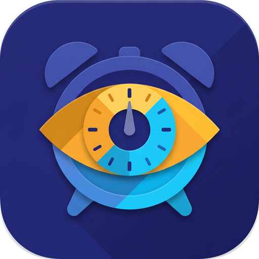
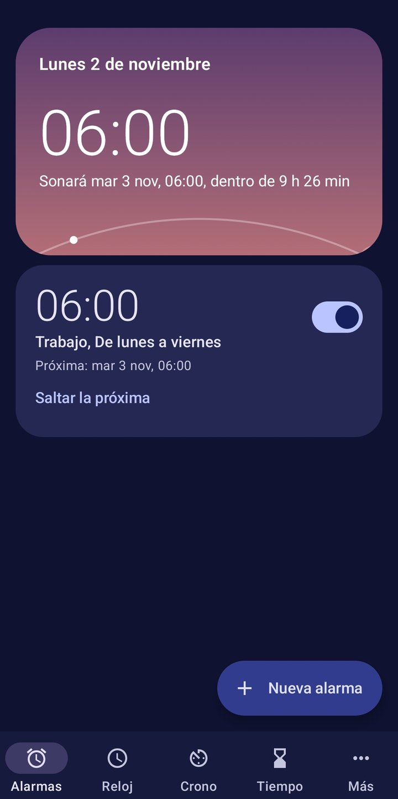
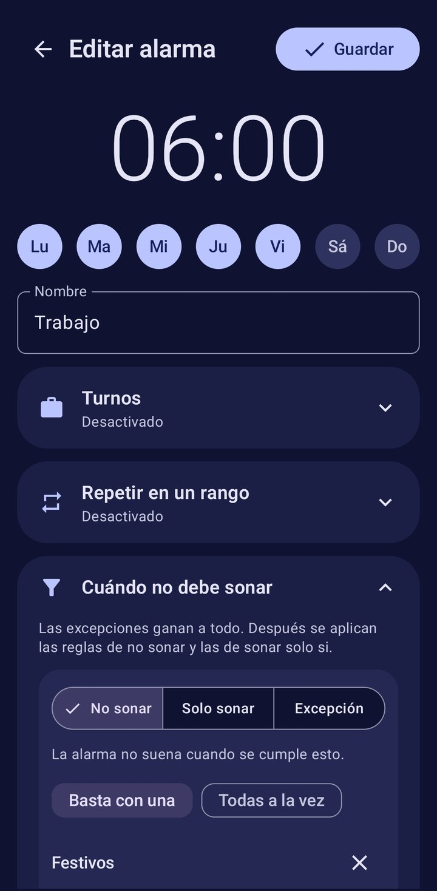
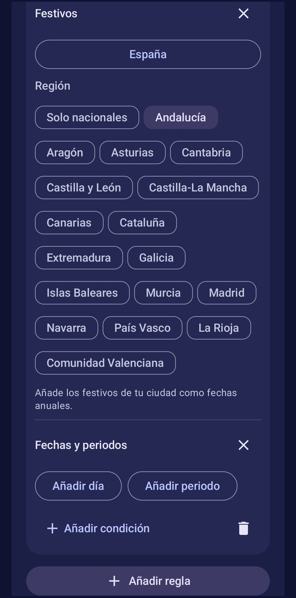
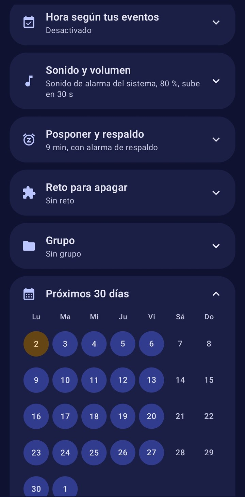
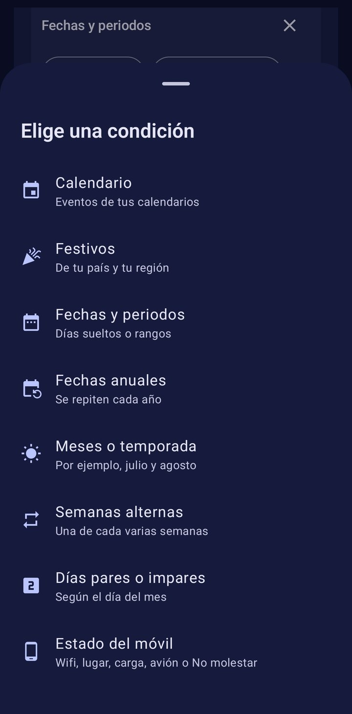
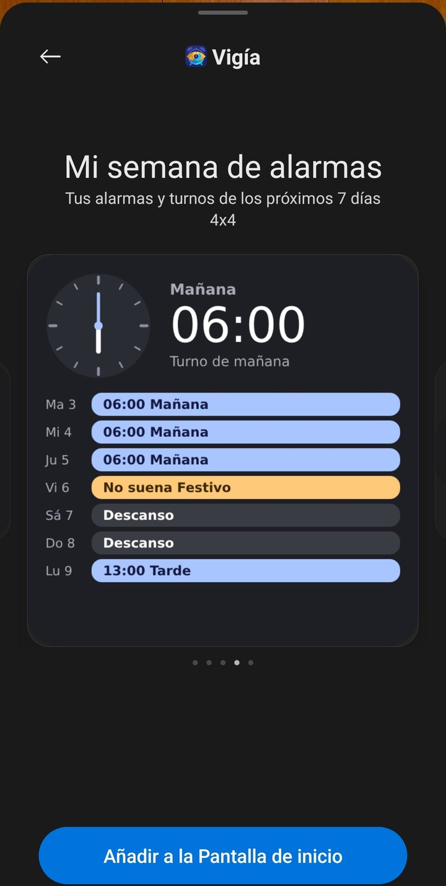
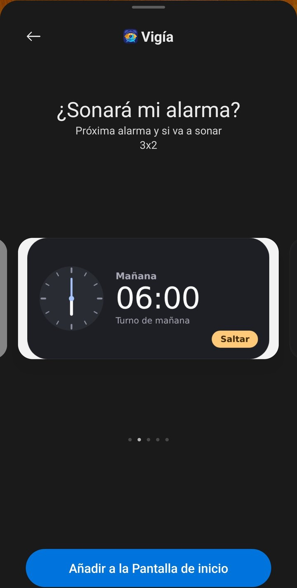

**Español** · [English](README.en.md)

# Vigía: la alarma que entiende tu vida

**Tu vida no se repite de lunes a viernes. Tu alarma tampoco debería.**

Vigía es una app gratuita de alarmas para Android que decide qué días debe sonar según tus turnos, tu calendario, los festivos y tu situación. Configúrala una vez y olvídate de encender y apagar alarmas cada noche.

La regla de oro es sencilla: si Vigía no tiene datos suficientes para decidir, la alarma suena.

## Capturas

  
  
  

  
  
  

  

## Los problemas que te quita de encima

### Trabajas por turnos

Si trabajas cuatro días y descansas dos, tu semana nunca coincide con la del calendario. Las alarmas normales te obligan a recalcular y a tocar ajustes constantemente.

Con Vigía creas tus turnos, cada uno con su hora, y pintas tu cuadrante día a día. El ciclo puede durar lo que necesites, por ejemplo tres semanas: mañana, tarde y descanso. Vigía lo repite sin límite y cada día suena a la hora de ese turno.

Si te cambian un día, lo tocas en el calendario sin alterar el ciclo. Si tu cuadrante cambia cada mes, puedes pintar el mes entero o poner eventos como “Mañana” o “Tarde” en tu calendario, y Vigía usará la hora de cada turno.

Es una ayuda directa para personal sanitario, policías, bomberos, vigilantes, operarios, hostelería y cualquiera con un cuadrante rotativo.

### Los festivos te despiertan para nada

Es el clásico: festivo entre semana, por fin puedes dormir y suena la alarma de siempre. O peor, la apagas la noche anterior y al día siguiente se te olvida activarla.

Elige tu país y tu región una vez, y Vigía saltará esos festivos cada año. Los días propios de tu ciudad se añaden una vez como fechas anuales.

### Te vas de vacaciones y olvidas las alarmas

Si tus vacaciones ya están en tu calendario de Google, no hace falta repetirlas. Vigía lee el calendario sincronizado en el móvil y deja de sonar esos días. Cuando se acaban, vuelve sola.

También puedes filtrar por palabras, como “vacaciones” o “baja”, y elegir solo los eventos de día completo.

### Tus semanas no son todas iguales

Hay semanas de oficina y semanas de teletrabajo. Hay custodias compartidas, clases alternas y rutinas que cambian cada quince días.

Vigía entiende las semanas alternas, los días pares o impares y los meses concretos. Puedes hacer que una alarma descanse en julio y agosto y regrese en septiembre.

### Algunos días solo debe sonar si hay algo importante

Puedes darle la vuelta a la lógica: que la alarma suene únicamente si tu calendario tiene un evento llamado “Oficina”, y que el resto de días te deje dormir.

También admite excepciones: no sonar en festivos, salvo que tengas un evento “Guardia”. Las excepciones siempre ganan, para que lo importante no se pierda.

### Tu hora de levantarte depende de tu agenda

Si tu primera cita cambia cada día, Vigía puede sonar antes del primer evento, por ejemplo 90 minutos antes. Tú solo mantienes el calendario al día.

### Tu situación cambia, y la alarma debería notarlo

Vigía puede tener en cuenta dónde estás y cómo está tu móvil en el momento de sonar: una wifi concreta, un lugar, el móvil cargando, el modo avión o No molestar.

### Apagas la alarma sin despertarte

Puedes exigir un reto para apagarla: resolver cálculos, sacudir el móvil, caminar unos pasos o escanear un código QR que tengas en el baño o en la cocina.

Si nadie la apaga, la alarma de respaldo vuelve a sonar al máximo. Y si prefieres un despertar suave, el volumen puede subir poco a poco mientras un amanecer llena la pantalla.

### Necesitas diez alarmas para levantarte

Hay quien programa una alarma cada 5 minutos porque con una no basta. Con el modo perezosos extremos eliges un rango y un intervalo, por ejemplo de 06:30 a 07:30 cada 5 minutos, y creas una sola alarma.

No hay botón de posponer. **Detener** la calla hasta el siguiente intervalo y **Detener por hoy** cancela las que quedan. Si le pones un reto, solo te lo pedirá para detenerla por hoy. También puedes activar este modo en un turno concreto.

### Tienes muchas alarmas y cambian por épocas

Los grupos reúnen varias alarmas bajo un nombre, como “Trabajo”, “Verano” o “Niños”. En la lista se pliegan para que todo quede ordenado, y un solo interruptor enciende o apaga todas las alarmas del grupo.

Así, cuando acaba el curso, apagas “Colegio” de una vez y lo recuperas en septiembre sin rehacer nada.

### Quieres saber qué pasará mañana

No tienes que fiarte a ciegas. La previsión muestra los próximos 30 días y, al tocar uno, te explica si sonará y por qué.

La noche anterior, Vigía te avisa si una alarma no va a sonar y te ofrece un botón para que suene igualmente. Y si un día concreto no la necesitas, puedes saltar solo la próxima.

Ni siquiera hace falta abrir la app. El widget te dice si sonará y por qué, con un color claro para cada estado y en cuatro tamaños, desde uno mínimo de 2x1 hasta uno con toda tu semana. Su fondo puede ser opaco, semitransparente o transparente. Desde él, o desde el panel rápido, puedes saltar la alarma o hacer que suene.

## Cómo funciona

Cada alarma tiene una hora, unos días y tus reglas. Antes de sonar, Vigía comprueba:

1. Si le has pedido que suene ese día, suena.
2. Si has saltado ese día a mano, no suena.
3. Si se cumple una excepción, suena.
4. Si se cumple una regla de no sonar, no suena.
5. Si falta una condición de sonar solo si, no suena.
6. En cualquier otro caso, suena.

Tus alarmas y tus datos del calendario se quedan en tu móvil. No necesitas crear una cuenta. Para los festivos, Vigía solo envía el código del país y guarda las fechas para poder usarlas sin conexión.

Si el calendario no se puede leer o faltan los festivos, la alarma suena y te avisa.

## Todo lo que incluye

- **Reglas:** calendarios por cuenta, palabras clave, eventos de día completo u ocupado, festivos, fechas, meses, semanas alternas, días pares o impares, y estado del móvil.
- **Turnos:** cuadrante pintable, ciclos de hasta 12 semanas, una hora por turno, cambios puntuales, meses pintados y turnos desde tu calendario.
- **Alarmas:** grupos, plantillas, alarmas de un solo uso, repetición dentro de un rango, previsión de 30 días y saltar la próxima.
- **Despertar:** tono o archivo propio, volumen máximo, subida progresiva, vibración y aplazamiento configurable.
- **Apagado:** cálculo, sacudir, caminar, código QR y alarma de respaldo.
- **Reloj:** otras ciudades, modo nocturno y salvapantallas.
- **Widgets:** estado de hoy o mañana, motivo, botones para saltar o hacer sonar, vista de la semana y botón del panel rápido.
- **Cronómetro:** vueltas, exportación y notificación persistente.
- **Temporizadores:** varios a la vez, con nombre, encadenados y por intervalos.
- **Sueño:** hora recomendada para acostarte y estadísticas de los últimos 14 días.
- **Control:** historial con motivos, pantalla de fiabilidad y copia de seguridad.
- **Apariencia:** modo claro u oscuro, paletas de colores y Material You.

## Requisitos

Funciona en Android 10 o posterior y está disponible en español e inglés. Antes de confiar en ella, haz la prueba de alarma con el móvil bloqueado, porque algunas marcas limitan las apps en segundo plano.

## Autoría y derechos

Creada por manarjomar. © 2026 manarjomar. Todos los derechos reservados.

Puedes descargar e instalar Vigía gratis para tu uso personal. El código se publica para consulta: no se concede permiso para modificarlo, redistribuirlo ni publicar versiones derivadas.

Los festivos internacionales proceden de [Nager.Date](https://date.nager.at).

## Compilación

Cada envío a `main` ejecuta las pruebas y genera un APK de prueba. Para publicar una versión en **Releases**, cambia el número de `version.txt` y sus notas en `release-notes.md`. La firma usa los secretos `KEYSTORE_BASE64` y `SIGNING_PASSWORD`. No cambies esa clave: Android rechazaría las actualizaciones.

## Puesta en marcha

1. Instala el APK.
2. Abre **Más**, **Fiabilidad y ajustes**, y deja todas las comprobaciones en **Correcto**.
3. Completa los ajustes del fabricante.
4. Pulsa **Probar alarma en 1 minuto** y bloquea el móvil.
5. Repite la prueba tras cerrar la app desde recientes y tras reiniciar el móvil.

Tras un reinicio, desbloquea el móvil una vez: Android no entrega el evento de arranque a la app hasta entonces.
